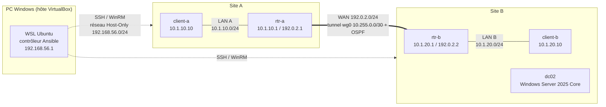

# LogiNord — infrastructure multi-site Linux / Windows

> Projet du cours **B3 Administration système Linux & Windows** (2026).
> Une infrastructure fictive pour le client **LogiNord**, entièrement décrite en code avec **Ansible** :
> deux sites, des serveurs Debian et Windows Server, un tunnel chiffré entre les sites, du routage dynamique et un accès d'administration sécurisé.

**Auteur :** Jawad

---

## Sommaire

1. [Le besoin du client](#le-besoin-du-client)
2. [Avancement des TP](#avancement-des-tp)
3. [Architecture du lab](#architecture-du-lab)
4. [Structure du dépôt](#structure-du-dépôt)
5. [Démarrage rapide](#démarrage-rapide)
6. [Les rôles Ansible](#les-rôles-ansible)
7. [Secrets et sécurité](#secrets-et-sécurité)
8. [Documentation détaillée](#documentation-détaillée)
9. [Ajouter un nouveau TP](#ajouter-un-nouveau-tp)

---

## Le besoin du client

LogiNord a **deux sites** (A et B), des machines **Linux et Windows**, et quelques exigences qui guident tout le projet :

| Ce que dit le client | Ce que ça impose techniquement | Traité dans |
|---|---|---|
| « Si mon informaticien part, un autre doit pouvoir tout reconstruire. » | Toute la configuration est du code, lisible, versionné, rejouable | MC01 |
| « Nos deux sites doivent se parler. » | Un tunnel chiffré entre les sites (WireGuard) | MC02 |
| « On pense ouvrir un troisième site. » | Routage dynamique (OSPF) : un nouveau site s'annonce tout seul | MC02 |
| « Mes informaticiens doivent pouvoir intervenir de chez eux, sans ouvrir la porte aux pirates. » | SSH par clé uniquement, PowerShell Remoting, journaux lisibles | MC03 |
| « Savoir qui a fait quoi. » | Une clé SSH par personne, journaux d'authentification | MC03 |

---

## Avancement des TP

| TP | Sujet | État | Documentation |
|---|---|---|---|
| **MC01** | Ansible pour une infra multi-site (structure, inventaire, rôle `baseline`, vault, Windows via WinRM) | ✅ Terminé | [docs/mc01-ansible-multisite.md](docs/mc01-ansible-multisite.md) |
| **MC02** | Le réseau côté système (routeurs Debian, nftables, WireGuard, FRR / OSPF) | ✅ Terminé | [docs/mc02-reseau-wireguard-ospf.md](docs/mc02-reseau-wireguard-ospf.md) |
| **MC03** | Administration à distance sécurisée (SSH durci, PowerShell Remoting) | ✅ Terminé | [docs/mc03-administration-distance.md](docs/mc03-administration-distance.md) |
| MC04 + | À venir (Active Directory, partages, supervision… selon le cours) | ⏳ | [docs/_modele-tp.md](docs/_modele-tp.md) |

Critère commun à tous les TP : **`ansible-playbook site.yml` passe sans erreur, et le second passage affiche `changed=0`** (idempotence).

---

## Architecture du lab



| Machine | Rôle | Système | IP d'administration (Host-Only) | IP(s) du lab |
|---|---|---|---|---|
| `rtr-a` | Routeur du site A | Debian 13 | 192.168.56.10 | LAN 10.1.10.1/24 · WAN 192.0.2.1/24 · wg0 10.255.0.1/30 |
| `rtr-b` | Routeur du site B | Debian 13 | 192.168.56.11 | LAN 10.1.20.1/24 · WAN 192.0.2.2/24 · wg0 10.255.0.2/30 |
| `client-a` | Poste du site A | Debian 13 | 192.168.56.12 | 10.1.10.10/24 |
| `client-b` | Poste du site B | Debian 13 | 192.168.56.13 | 10.1.20.10/24 |
| `dc02` | Serveur Windows du site B | Windows Server 2025 Core | 192.168.56.20 | — |

Chaque VM a aussi une carte **NAT** VirtualBox pour accéder à Internet (installation des paquets).
Détails de l'environnement : [docs/00-environnement.md](docs/00-environnement.md).

---

## Structure du dépôt

```
loginord-infra/
├── README.md                  ← vous êtes ici
├── ansible.cfg                réglages du projet (inventaire, fichier du mot de passe vault)
├── site.yml                   point d'entrée : quels rôles sur quels groupes
├── inventory/
│   └── hosts.yml              les machines, rangées par site (site_a, site_b) et par rôle (routers, clients, linux, windows)
├── group_vars/                variables par groupe
│   ├── all.yml                NTP, fuseau horaire, compte d'administration
│   ├── site_b.yml             surcharge du site B (serveur NTP)
│   ├── linux.yml              connexion SSH + sudo
│   ├── windows.yml            connexion WinRM
│   └── routers.yml            réglages communs des routeurs (OSPF, WireGuard)
├── host_vars/                 variables propres à une machine (IP, clés publiques WireGuard, OSPF)
├── roles/
│   ├── baseline/              socle commun Linux + Windows       (MC01)
│   ├── network/               une interface = un fichier          (MC02)
│   ├── router/                routage + pare-feu nftables          (MC02)
│   ├── wireguard/             tunnel chiffré entre les sites       (MC02)
│   ├── frr/                   routage dynamique OSPF               (MC02)
│   └── ssh_hardening/         SSH durci                            (MC03)
├── vault/
│   ├── secrets.yml            secrets CHIFFRÉS (ansible-vault)
│   └── secrets.yml.exemple    la liste des variables attendues, avec des valeurs factices
└── docs/                      la documentation détaillée de chaque TP
```

---

## Démarrage rapide

**Prérequis** (détails dans [docs/00-environnement.md](docs/00-environnement.md)) :

- les VM créées et joignables sur le réseau Host-Only (seul geste manuel) ;
- un contrôleur Linux (ici WSL Ubuntu 24.04) avec Ansible :
  ```bash
  sudo apt install -y ansible python3-winrm python3-passlib wireguard-tools git
  ```
- le mot de passe du vault dans `~/.vault_pass` (hors du dépôt, `chmod 600`).

**Lancer :**

```bash
git clone <url-du-depot> && cd loginord-infra

ansible-inventory --graph                                     # voir l'inventaire
ansible linux   -m ansible.builtin.ping     -e @vault/secrets.yml
ansible windows -m ansible.windows.win_ping -e @vault/secrets.yml

ansible-playbook site.yml                     # tout construire
ansible-playbook site.yml                     # 2e passage : changed=0 attendu
ansible-playbook site.yml --limit linux       # seulement les Debian (dc02 éteint, par exemple)
```

> ⚠️ Le dépôt doit être cloné **dans le système de fichiers Linux** de WSL (`~/…`), pas sous `/mnt/c/…` :
> Ansible ignore un `ansible.cfg` placé dans un dossier accessible en écriture à tous.

---

## Les rôles Ansible

| Rôle | Cibles | Ce qu'il fait | TP |
|---|---|---|---|
| [`baseline`](roles/baseline/README.md) | toutes | Nom d'hôte, fuseau horaire, NTP (chrony / w32time), compte d'administration `sysadmin` | MC01 |
| [`network`](roles/network/README.md) | routeurs, clients | Un fichier `/etc/network/interfaces.d/<interface>` par interface, routes statiques des clients | MC02 |
| [`router`](roles/router/README.md) | routeurs | `ip_forward`, pare-feu nftables (`input` et `forward` en `policy drop`) | MC02 |
| [`wireguard`](roles/wireguard/README.md) | routeurs | Tunnel `wg0` entre les sites (`Table = off`, multicast activé pour OSPF) | MC02 |
| [`frr`](roles/frr/README.md) | routeurs | FRR + OSPF : chaque routeur annonce son LAN, les routes s'apprennent seules | MC02 |
| [`ssh_hardening`](roles/ssh_hardening/README.md) | linux | Groupe `ssh-admins`, clés déposées, root et mots de passe refusés, validation `sshd -t` avant rechargement | MC03 |

---

## Secrets et sécurité

- **Aucun secret en clair dans Git.** Mots de passe et clés privées WireGuard sont dans `vault/secrets.yml`, chiffré avec `ansible-vault` (AES256).
- **Le mot de passe du vault n'est jamais dans le dépôt** : il est dans `~/.vault_pass` sur le contrôleur (exclu par `.gitignore`).
- Les variables secrètes sont préfixées `vault_` (`vault_win_password`, …) et reprises ailleurs par une variable claire (`ansible_password: "{{ vault_win_password }}"`). On sait ainsi d'un coup d'œil d'où vient une valeur.
- Les tâches qui manipulent un mot de passe ont `no_log: true`.
- Les clés **publiques** WireGuard sont dans `host_vars/` : elles ne sont pas secrètes.
- `vault/secrets.yml.exemple` liste les variables attendues avec des valeurs factices, pour qu'un repreneur sache quoi remplir.

Gestion du vault :

```bash
ansible-vault view vault/secrets.yml     # lire
ansible-vault edit vault/secrets.yml     # modifier (éditeur : export EDITOR=nano)
head -1 vault/secrets.yml                # doit afficher $ANSIBLE_VAULT;1.1;AES256
```

---

## Documentation détaillée

| Document | Contenu |
|---|---|
| [docs/00-environnement.md](docs/00-environnement.md) | Le poste, VirtualBox, WSL, les réseaux, la création des VM (modèle Debian, Windows Server Core), les gestes manuels |
| [docs/mc01-ansible-multisite.md](docs/mc01-ansible-multisite.md) | MC01 : structure du projet, inventaire à deux axes, précédence des variables, vault, Windows via WinRM |
| [docs/mc02-reseau-wireguard-ospf.md](docs/mc02-reseau-wireguard-ospf.md) | MC02 : routeurs Debian, nftables, WireGuard, OSPF, vérifications |
| [docs/mc03-administration-distance.md](docs/mc03-administration-distance.md) | MC03 : SSH durci, tests, journaux, PowerShell Remoting |
| [docs/depannage.md](docs/depannage.md) | Tous les problèmes rencontrés pendant les TP, leur cause et leur solution |
| [docs/_modele-tp.md](docs/_modele-tp.md) | Le modèle à copier pour documenter un nouveau TP |

---

## Ajouter un nouveau TP

1. Copier `docs/_modele-tp.md` en `docs/mcXX-sujet.md` et le remplir au fur et à mesure.
2. Créer le ou les rôles dans `roles/` (un rôle = une responsabilité), avec un court `README.md`.
3. Ajouter un play dans `site.yml` et, si besoin, des groupes dans `inventory/hosts.yml`.
4. Mettre de nouveaux secrets dans le vault (préfixe `vault_`) et les déclarer dans `vault/secrets.yml.exemple`.
5. Vérifier : `ansible-playbook site.yml` deux fois → `changed=0`.
6. Mettre à jour le tableau [Avancement des TP](#avancement-des-tp), puis :
   ```bash
   git add . && git commit -m "MCXX : <sujet>" && git tag mcXX && git push --follow-tags
   ```
